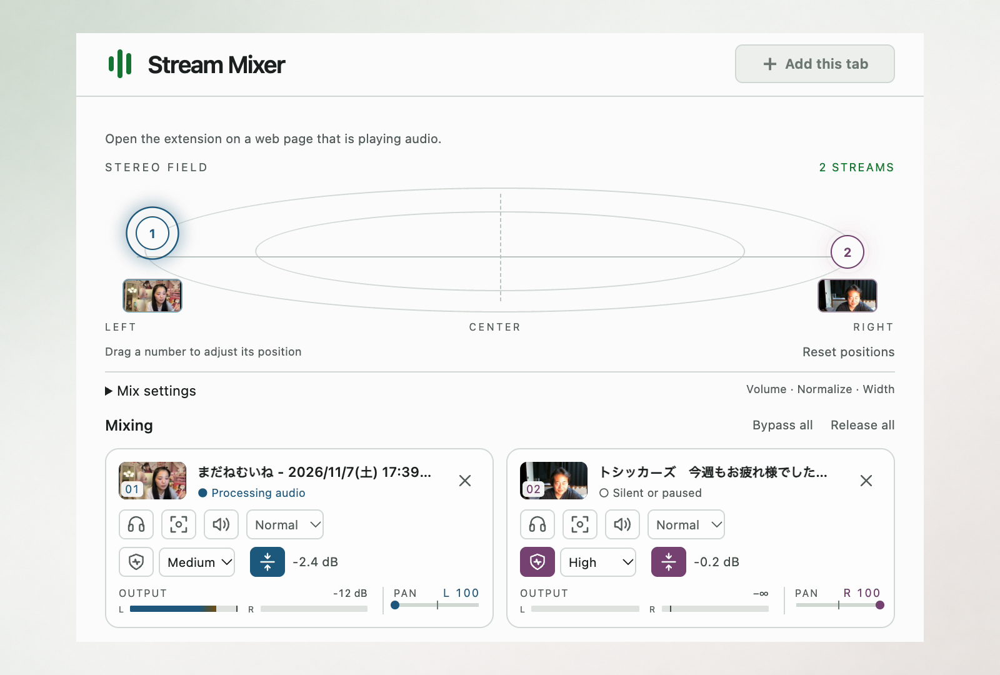

# Stream Mixer



A Chrome extension that balances live-stream audio levels and stereo placement across tabs.

## Features

- Automatic volume balancing and stereo placement.
- Global volume, normalization strength, and stereo width controls.
- Per-stream normalization, volume, mute, and noise reduction.
- Solo to hear one stream; Focus to keep selected streams at normal levels and lower others by 18 dB.
- Draggable stereo markers and reorderable stream cards, with audio meters and available video thumbnails.
- English and Japanese, with system-matched light and dark themes.

## Installation

- [Chrome Web Store](https://chromewebstore.google.com/detail/gkoocgnchdnibgbgbkobpjpajaldgemc)

## Usage

1. Play audio in an unmuted HTTP(S) tab, open **Stream Mixer**, and click **Add this tab**. Repeat for each stream.
2. Adjust **Mix settings** globally or use each stream's card controls.
3. Drag a numbered **STEREO FIELD** marker to reposition and temporarily focus that stream. Releasing restores previous Solo or Focus selections.
4. **Bypass all** skips processing but keeps capture and per-stream mute active. **Resume mix** restores processing; **Release all** stops capture and restores normal tab playback.

Global settings are saved locally. After restarting Chrome, re-add tabs and reapply per-stream settings. Noise reduction targets speech and may reduce music or sound effects.

Closing the popup stops thumbnail updates; audio processing continues. Release or close a tab to stop its capture.

## Permissions

- `activeTab`: access to tabs where you open the extension.
- `tabCapture`: audio from added tabs.
- `tabs`: titles to identify playing and mixed tabs; URLs to check capture eligibility.
- `scripting`: video thumbnails from authorized tabs.
- `storage`: local settings and session notices.
- `offscreen`: audio processing with the popup closed.

Audio and thumbnails stay on-device; audio is not recorded. Tabs require manual addition, and protected content or site restrictions may prevent capture.

See the [Privacy Policy](PRIVACY.md) for data use, storage, retention, and controls.

## Development

Requires Node.js 22+. Load `extension/` directly in Chrome.

```shell
npm ci

# unit tests
npm test

# static checks
npm run check

# browser tests
npx playwright install chromium
npm run test:browser

# package a release ZIP in dist/
npm run release:package -- 0.1.0
```

Regenerate bundled RNNoise assets with `npm run vendor:nr`. See [third-party notices](extension/vendor/rnnoise/THIRD_PARTY_NOTICES.md) for sources and licenses.

## License

Original project code is licensed under the [MIT License](LICENSE). Bundled third-party components retain their own licenses; see [third-party notices](extension/vendor/rnnoise/THIRD_PARTY_NOTICES.md).
